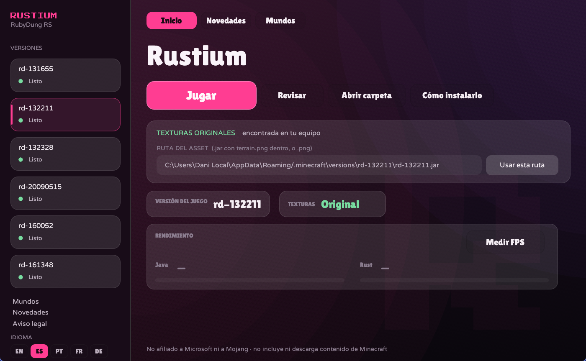
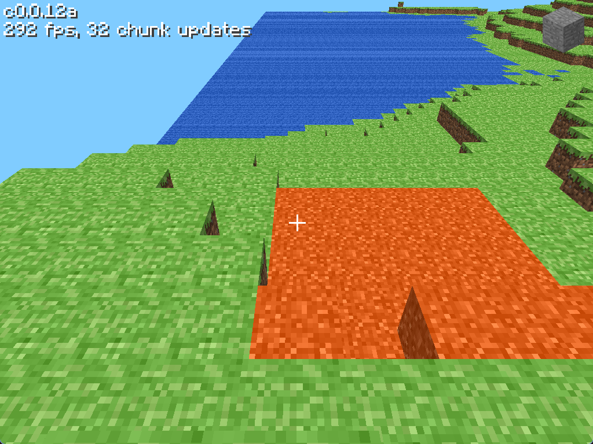
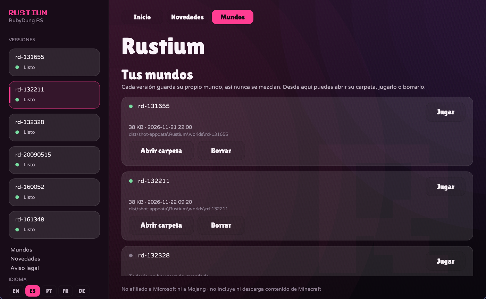
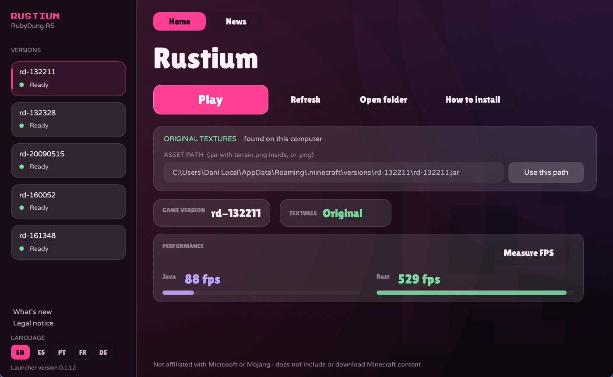
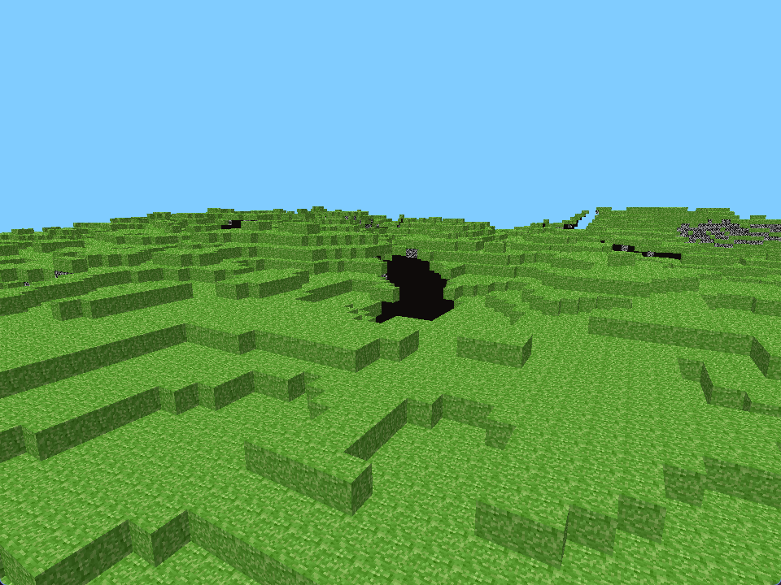

# Rustium

Launcher y port a Rust de las versiones pre-clásicas de Minecraft (rd-131655,
rd-132211, rd-132328, rd-20090515, rd-160052 y rd-161348), de las Classic private
alpha (mc-161607, mc-161616, mc-161625 y mc-161648) y de las primeras Classic
(c0.0.3a, c0.0.9a, c0.0.10a, c0.0.11a, c0.0.12a y sus continuaciones hasta
c0.0.13a_03), sin cuenta de Microsoft y sin
descargar nada de Mojang: lee las texturas de la copia que ya tengas en el ordenador
y, si no hay ninguna, dibuja las suyas.

*[Read in English](README.md)*

## Cómo es











## Para jugar

Solo hace falta **el instalador**: `Rustium-0.3.7-setup.exe`.

- Nada más. No hay que instalar Rust, ni Java, ni el launcher oficial, ni una cuenta.
- Se instala por usuario en `%LOCALAPPDATA%\Rustium`, sin permisos de administrador.
- `Rustium.exe` y un ejecutable de juego por versión van dentro del instalador ya
  compilados y enlazados en estático: las únicas DLLs que usan son las del propio
  Windows.
- `.minecraft` es opcional. Java solo se usa si pulsas "Measure FPS".

## Las versiones

El selector encima de «Jugar» arranca cualquiera de las treinta y siete versiones (las seis
pre-clásicas, las cuatro alpha privadas y las veinte primeras Classic):

| versión | qué trae |
|---|---|
| rd-131655 | el Cave game tech test: hierba en terrazas, roca y cuevas enormes, sin inventario y sin poder tocar bloques |
| rd-132211 | el mundo de RubyDung: césped, piedra y el velo que pulsa en el bloque que miras |
| rd-132328 | el primer móvil, los zombis, con su piel de Steve |
| rd-20090515 | partículas, más bloques y el cubo del bloque en la esquina |
| rd-160052 | el mismo motor, un build anterior |
| rd-161348 | el último build pre-clásico (su jar es el mismo que el de rd-20090515) |
| mc-161607 | reconstruida: la primera Minecraft que jugó alguien; Escape libera el ratón y no hay número de versión en pantalla |
| mc-161616 | reconstruida: la Y invierte el eje del ratón |
| mc-161625 | reconstruida: arregla las texturas y el invertido del ratón |
| mc-161648 | reconstruida: arregla el ratón; el último build sin número de versión |
| c0.0.3a | reconstruida: las cuevas vuelven, a 1024×768, antes del modo construir y del contador de fps |
| c0.0.9a | reconstruida: el modo construir con el velo blanco por las seis caras, contador de fps, a 640×480 y Escape cierra |
| c0.0.10a | reconstruida: igual que 0.0.9a pero Escape solo suelta el ratón |
| c0.0.11a | la primera Classic conservada: terreno con cuevas de `NoiseMap`, HUD con fps y chunk updates, y el modo pintar que cambia con el botón derecho |
| c0.0.12a | reconstruida: agua, lava y bedrock: océano alrededor de las islas, lagos de lava y natación; solo 1/2/3/4/6 seleccionan bloques, como en la build archivada |
| c0.0.12a_01 | reconstruida: como 0.0.12a, con el reinicio de mobs al crear un nivel |
| c0.0.12a_02 | reconstruida: la mejora de rendimiento de 0.0.12a, sin cambios de juego |
| c0.0.12a_03 | el reupload archivado de 0.0.12a: correcciones de guardado y rendimiento |
| c0.0.13a | reconstruida a partir de la build de desarrollo archivada: 854×480, salto de 0.0.11a, física de agua/lava, niebla azul/roja y el mundo plano de 32×512×64 con cuevas y lava subterránea |
| c0.0.13a_03 | oficial y archivada: 854×480, sin lagos de lava sobre el nivel del mar y sin mobs naturales |
| c0.0.14a | reconstruida: arena, grava y las tres menas, árboles de tronco y hojas, arena y grava que caen, nubes, niebla lineal azul, paleta de nueve bloques y el atlas de 0.0.14a |
| c0.0.14a_08 | desarrollo: copa en cruz, niebla blanca y sombras en agua y lava |
| c0.0.15a | primer test multijugador: grava solo bajo el agua, árboles de roble pequeño y lava más lenta y brillante |
| c0.0.15a_01 | reupload: mejor interpolación del cliente, sin cambios de juego en el port |
| c0.0.15a_02 | reupload: animaciones corregidas, sin cambios de juego en el port |
| c0.0.16a | comandos de servidor adaptados a un jugador: T abre la consola, `/broadcast` escribe en el registro y `/kick` explica que no hay nadie más |
| c0.0.16a_02 | último test multijugador: niebla índigo bajo el agua en vez de blanca |
| c0.0.17a | `/setspawn`, `/spawn` y la lista de jugadores con Tab; el registro de chat aparece al escribir |
| c0.0.18a | `/teleport <x> <y> <z>` (o `/tp`), adaptado del comando de admin a coordenadas |
| c0.0.18a_02 | la fuente acepta `\`, `|`, `@` y `$`; la consola de chat los deja pasar |
| c0.0.19a | cristal, esponja, bloque de oro, barra rápida de nueve bloques, agua y lava animadas y límite de 100 fps |
| c0.0.19a_06 | corrección del temporizador de 0.0.19a: mismos bloques y barra, ticks más estables |
| c0.0.20a | inventario con B, dieciséis telas, dienteleones, rosas, setas, `/solid` y bedrock irrompible |
| c0.0.20a_02 | arreglo de la transparencia del agua de 0.0.20a, con el inventario y las plantas intactos |
| c0.0.21a | fondo gris del inventario, se puede andar y cambiar de casilla con él abierto, auto-clic y más alcance de construcción |
| c0.0.22a | efectos de sonido sintetizados al colocar y romper, M los silencia y la lava fluye más despacio |
| c0.0.23a | Escape abre un menú de opciones para FPS, invertir el ratón, distancia y sonido; la última Classic creativa |

Las cuatro mc-, c0.0.3a, c0.0.9a, c0.0.10a, c0.0.12a, c0.0.12a_01, c0.0.12a_02,
c0.0.13a, c0.0.14a, c0.0.15a, c0.0.15a_01, c0.0.15a_02, c0.0.16a, c0.0.16a_02,
c0.0.17a, c0.0.18a, c0.0.18a_02, c0.0.19a, c0.0.20a, c0.0.21a, c0.0.22a y c0.0.23a son **reconstrucciones**: sus jars nunca se archivaron. Salen del código de
c0.0.11a y de lo que documenta la Minecraft Wiki de cada una, y llevan las texturas y
la fuente de c0.0.11a cuando no hay un jar propio. El launcher las marca con **REC**
en el selector y en la lista de instancias; el id y la carpeta del mundo no cambian.

rd-131655 (el «Cave game tech test») nunca tuvo jar publicado. Está reconstruido
a partir de la Minecraft Wiki y usa las mismas texturas de RubyDung que rd-132211.

`c0.0.14a` también está perdida: sus tiles nuevos salen del jar archivado de
0.0.14a_08 y su generador sigue lo que documenta la wiki: playas, menas de 10-30
bloques y árboles. La reconstrucción de **0.0.14a** sigue el comportamiento de la
base: copa cuadrada y niebla azul lineal. `c0.0.14a_08` es una build aparte, con
lo que la wiki documenta para el desarrollo: copa en cruz, niebla blanca y sombras
en agua y lava. Del jar de `_08` se toman las texturas que la release perdida no
conserva. `c0.0.15a` cambia la grava a solo bajo el agua, estrena la copa de
roble pequeño y hace que la lava fluya más despacio y salga más brillante.

`c0.0.13a` sigue el jar que el launcher oficial archiva con ese nombre: la build de
desarrollo para probar el tamaño del mundo, no la release perdida. Genera el mundo
plano documentado de 32×512×64, cava cuevas y siembra lava bajo tierra. Su
`level.dat` usa la cabecera de 0.0.13a (magia `0x271BB788`, nombre, autor, fecha y
ancho/alto/profundidad); la cabecera también se lee, así que los niveles con otras
dimensiones, como los documentados 1024×64×64 y 512×64×512, se cargan y se dibujan.
Los guardados anteriores a 0.0.13a conservan el formato crudo de bloques y siguen
abriéndose.

## Tus mundos

Cada instancia guarda su mundo en `%APPDATA%\Rustium\worlds\<instancia>\level.dat`
por defecto, y puede apuntar a cualquier otra carpeta desde sus opciones, así que
una partida de rd-132211 nunca se abre con los bloques de otra familia. Las
instancias por defecto reutilizan el id de la versión, así que los mundos guardados
antes de que existieran las instancias siguen en su sitio. Cada instancia también
recuerda el tamaño inicial de su ventana; deja la resolución vacía para usar el
tamaño que tenía esa versión originalmente. La pestaña
**Mundos** del launcher enseña cuánto ocupa cada uno y cuándo lo jugaste, abre su
carpeta y lo borra con confirmación. Justo debajo están las instalaciones con su
carpeta.

## Para compilar desde el código

Requisitos:

- Rust estable con el objetivo `x86_64-pc-windows-gnu` (`rustup target add
  x86_64-pc-windows-gnu`).
- Un **MinGW-W64 GCC** de verdad, con su `x86_64-w64-mingw32-gcc.exe`.

Las dependencias de Rust las baja cargo solo; lo que no viene solo es el enlazador.

### Por qué hace falta decir cuál usar

El `x86_64-w64-mingw32-gcc` que suele estar en el PATH es el de **llvm-mingw**, que es
clang disfrazado. Ese driver no enlaza bien el `std` de Rust para Windows: falla incluso
al compilar un build script, con

```
ld.lld: error: undefined symbol: _Unwind_SetGR
ld.lld: error: undefined symbol: _GCC_specific_handler
ld.lld: error: undefined symbol: _Unwind_RaiseException
error: could not compile `parking_lot_core` (build script)
```

Es porque el `std` de `*-windows-gnu` espera los símbolos de unwind que exporta
MinGW-W64 (`libgcc_s`/`libunwind`) y el enlazador de llvm-mingw no los pone ahí. No es
un problema del código: con un GCC de MinGW-W64 enlaza a la primera.

### Compilar

Apunta cargo al GCC bueno con una variable de entorno, sin tocar el repo:

```bash
CARGO_TARGET_X86_64_PC_WINDOWS_GNU_LINKER="C:/mingw64/bin/x86_64-w64-mingw32-gcc.exe" \
cargo build --release --target x86_64-pc-windows-gnu --bins
```

Cambia esa ruta por la de tu MinGW-W64 (en el PC de desarrollo está en
`C:\m\bin\x86_64-w64-mingw32-gcc.exe`). También vale un `.cargo/config.toml` local con
la misma ruta; no se versiona porque es de cada máquina.

Los ejecutables quedan en `target/x86_64-pc-windows-gnu/release/` y todos tienen que
estar en la misma carpeta, porque el launcher busca el .exe de la versión elegida al
lado.

### Instalador

Con los `.exe` ya compilados y [Inno Setup 6](https://jrsoftware.org/isinfo.php)
instalado:

```powershell
powershell -ExecutionPolicy Bypass -File installer/build.ps1
```

Escribe `dist/Rustium-0.3.7-setup.exe`, que es el archivo que se adjunta a un release.
El launcher busca ahí el asset `.exe` con su `size` y su `digest: sha256:…`, así que un
release sin SHA-256 publicado no se descarga ni se ejecuta.

## Licencia

Rustium se publica bajo la [licencia Apache 2.0](LICENSE), con el aviso de atribución
en [NOTICE](NOTICE).

Si lo redistribuyes, en código o ya compilado, tienes que conservar el aviso de
copyright y el archivo `NOTICE`, y marcar los archivos que cambies: el crédito a
**DandiMC** viaja con el código. La licencia además cede licencia de patentes y no
permite usar el nombre del proyecto como respaldo.

Eso cubre solo lo que hay aquí: no se incluye ni se licencia código, texturas ni ningún
otro material de Mojang, y el launcher no descarga nada de Mojang. Minecraft es una
marca de Mojang Studios; este proyecto no está afiliado a Mojang ni a Microsoft ni
cuenta con su respaldo.

Las tres fuentes incluidas van bajo la SIL Open Font License 1.1; sus avisos de
copyright están en [assets/fonts/OFL.txt](assets/fonts/OFL.txt).
