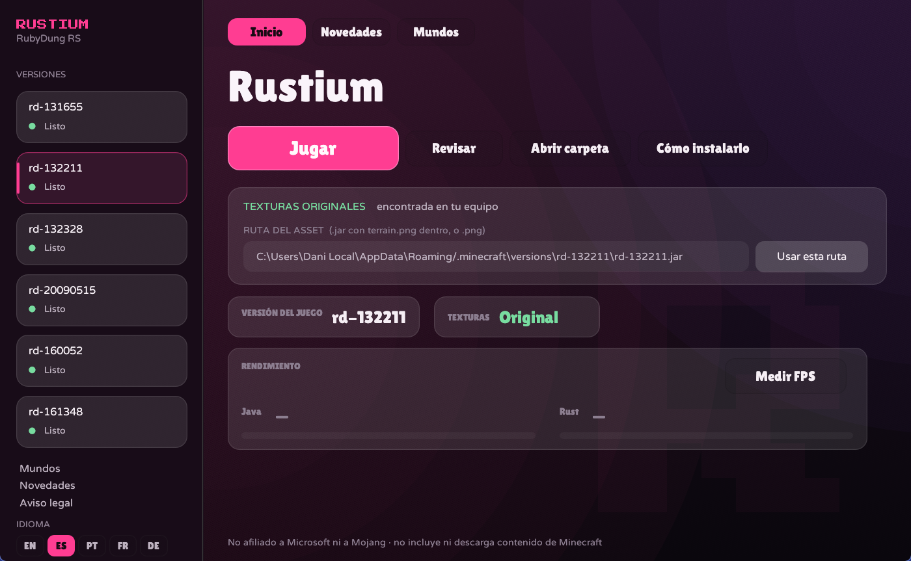
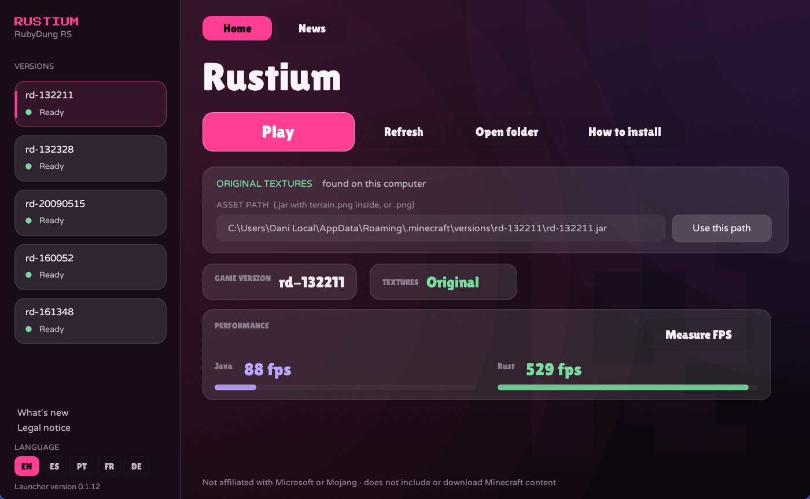

# Rustium

Launcher and Rust port of the first Minecraft version (rd-132211), with no
Microsoft account and nothing downloaded from Mojang: it reads the textures of the
copy already on your computer and, if there is none, draws its own.

*[Leer en español](README.es.md)*

## How it looks





## To play

You only need **the installer**: `Rustium-0.1.3-setup.exe`.

- Nothing else. No Rust, no Java, no official launcher, no account.
- It installs per user into `%LOCALAPPDATA%\Rustium`, with no administrator prompt.
- Both executables (`Rustium.exe` and `rubydung-rs.exe`) ship inside the installer
  already compiled and statically linked: the only DLLs they use are the ones that
  come with Windows.
- `.minecraft` is optional. Java is only used if you press "Measure FPS".

## To build from source

Requirements:

- Stable Rust with the `x86_64-pc-windows-gnu` target (`rustup target add
  x86_64-pc-windows-gnu`).
- A real **MinGW-W64 GCC**, with its `x86_64-w64-mingw32-gcc.exe`.

Cargo downloads the Rust dependencies by itself; what it does not bring is the linker.

### Why you have to tell it which one to use

The `x86_64-w64-mingw32-gcc` usually sitting in PATH is the one from **llvm-mingw**,
which is clang in disguise. That driver cannot link Rust's `std` for Windows: it fails
even while building a build script, with

```
ld.lld: error: undefined symbol: _Unwind_SetGR
ld.lld: error: undefined symbol: _GCC_specific_handler
ld.lld: error: undefined symbol: _Unwind_RaiseException
error: could not compile `parking_lot_core` (build script)
```

That is because the `std` of `*-windows-gnu` expects the unwind symbols exported by
MinGW-W64 (`libgcc_s`/`libunwind`), and the llvm-mingw linker does not put them there.
It is not a problem with the code: with a MinGW-W64 GCC it links first time.

### Building

Point cargo at the good GCC with an environment variable, no repo changes needed:

```bash
CARGO_TARGET_X86_64_PC_WINDOWS_GNU_LINKER="C:/mingw64/bin/x86_64-w64-mingw32-gcc.exe" \
cargo build --release --target x86_64-pc-windows-gnu --bin rustium --bin rubydung-rs
```

Change that path to your own MinGW-W64 (on the development PC it lives at
`C:\m\bin\x86_64-w64-mingw32-gcc.exe`). A local `.cargo/config.toml` with the same
path works too; it is not committed because it belongs to each machine.

The executables land in `target/x86_64-pc-windows-gnu/release/`, and both must end up
in the same folder, because the launcher looks for `rubydung-rs.exe` next to itself.

### Installer

With both `.exe` files already built and [Inno Setup 6](https://jrsoftware.org/isinfo.php)
installed:

```powershell
powershell -ExecutionPolicy Bypass -File installer/build.ps1
```

It writes `dist/Rustium-0.1.1-setup.exe`, the file to attach to a release. The launcher
looks there for the `.exe` asset with its `size` and its `digest: sha256:…`, so a
release without a published SHA-256 is neither downloaded nor run.

## License

Rustium is released under the [Apache License 2.0](LICENSE), with the attribution
notice in [NOTICE](NOTICE).

If you redistribute it, as source or as a built program, you must keep the copyright
notice and the `NOTICE` file, and mark the files you changed: the credit to **DandiMC**
travels with the code. The license also grants a patent license and does not allow
the use of the project's name as an endorsement.

That covers only what is here: no Minecraft code, textures or other Mojang assets
are included or licensed, and the launcher downloads nothing from Mojang. Minecraft
is a trademark of Mojang Studios; this project is not affiliated with or endorsed by
Mojang or Microsoft.

The three bundled fonts are under the SIL Open Font License 1.1; their copyright
notices are in [assets/fonts/OFL.txt](assets/fonts/OFL.txt).
